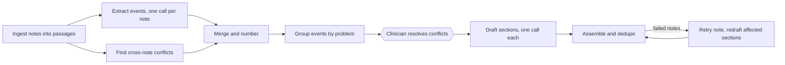

# Discharge Copilot

Hackathon demonstration using synthetic hospitalization notes. The app extracts cited clinical
events, resolves conflicting notes with clinician input, drafts a discharge summary, and supports
review, case questions, model-proposed corrections, approval, and Word export. It is not a clinical tool.

Stack: Python 3.12, FastAPI, LangGraph, the OpenAI Responses API with structured outputs, Pydantic,
PyMuPDF, python-docx, React 19, TypeScript, Vite, and Tailwind.

## How it works

Loading a case runs one LangGraph graph (`core/load_graph.py`). The API streams its progress to the
browser as server-sent events.



Design decisions:

- **Every fact points at a passage.** Ingest splits each note into immutable passages with stable IDs
  such as `note_04_p01_b03`. Events and conflicts must quote their passage verbatim.
  `core/validate.py` searches for each quote in the cited passage and drops evidence it can't find.
  Draft claims must cite passage IDs that exist. When validation fails, the model gets one retry
  with the errors attached.
- **Conflicts stop the pipeline.** The `resolve` node calls LangGraph's `interrupt`. The load stays
  paused until the clinician picks a documented value or types a clarification for each conflict.
  An in-memory checkpointer then resumes the graph. Drafting never sees the raw conflicting events,
  only the resolutions, and those keep `clinician-provided` provenance.
- **Fan out with `Send`.** Extraction, section drafting, and note retries run as parallel `Send`
  branches, capped at 6 concurrent calls. Merge and assembly sort by document order and template order,
  so the output never depends on which call finished first.
- **One call per section, one per problem.** The section list comes from `core/template.json`.
  Hospital course is drafted once for each clinical problem, after one model call merges each note's
  problem labels into a single list. Smaller calls keep each prompt narrow, and a failure only
  affects one section.
- **A failed note doesn't fail the load.** The first draft ships without it. The graph retries the
  note twice and redrafts only the sections whose input changed. If a note still fails, the draft
  names it.
- **Dedupe is guarded.** The model can only return claim IDs from an enum of existing IDs. Code keeps
  a flagged claim if it is the last one carrying a resolution or the last one in its section.
- **Questions use a second graph.** `core/review_graph.py` sorts each question into a section read,
  which needs no model call, or an answer grounded only in the note passages. Answers stream token by
  token from the partial structured output. The last three turns serve as context for follow-up
  questions, never as evidence.
- **Corrections are proposals.** The model rewrites one claim from the clinician's statement and the
  passages it cites. Nothing changes until the clinician accepts. Accepting resets approval.

## Set up and run

Run these commands from the repository root. Python 3.12 or later and Node.js 20.19 or later
are required. Node.js 22.12 or later also works with Vite 7.

```sh
uv sync
cp .env.example .env
```

Set `OPENAI_API_KEY` in `.env`. Set `LLM_MODEL` to a model available to your account that supports
structured outputs. Every load, correction proposal, and model-backed question uses the live API.
The backend loads `.env` without overriding existing environment variables. Speech settings in
the example file are unused by the current UI.

The committed `frontend/dist/` lets the backend serve the app without a separate frontend server:

```sh
.venv/bin/uvicorn api.app:app --host 127.0.0.1 --port 8000
```

Open <http://127.0.0.1:8000/>. The default UI is the blue CanvasApp workspace.

For frontend development, run these commands in `frontend/` while the backend runs on port 8000:

```sh
npm ci
npm run dev
```

Open <http://127.0.0.1:5173/>. Vite proxies `/api` requests to the backend.
After changing frontend source, rebuild the committed assets from `frontend/`:

```sh
npm run build
```

## Review a case

1. Choose `case_001`, `case_002`, or `case_003`, then click **Load case**.
2. Open the **Source notes** folder. Each card represents a supplied document and shows its
   actual extraction outcome. Select a card to inspect source passages and extracted events.
   Extraction runs in parallel. The UI does not invent individual task start times.
3. If the load pauses at **Resolve conflicts**, choose a documented value or type a clinician
   clarification for each conflict. Click **Review resolutions** to inspect the exact text to store.
   Click **Edit** to change choices or **Start drafting** to submit them and resume.
4. Select **Compose the draft** to inspect sections as they arrive. When the load and final
   snapshot finish, open **Results review**. Citation buttons open the contextual source inspector.
5. Select a claim and enter a **Clinician statement**, then click **Propose correction**.
   The model proposes the revised wording. Review **Before** and **After**, then **Accept** or **Reject**.
   Accepted corrections retain clinician provenance and require approval again.
6. Open **Ask about this case** after the draft is ready. Answers stream incrementally and
   include source citations. Minimize preserves the chat. **Stop answer** retains partial output.
7. Enter a **Reviewer**, click **Approve draft**, then **Download Word document** to export DOCX.
   A pending correction blocks approval and export.

Loading or switching cases clears the current workspace and chat. **Stop watching load** stops
the browser stream, while server work continues. Reload the case to begin a fresh session.

## Run checks

From the repository root:

```sh
.venv/bin/python -m pytest -q -p no:cacheprovider
git diff --check
```

From `frontend/`:

```sh
npm test
npm run build
```

The default backend test run excludes tests marked `live`. Frontend tests stub API responses and
exercise CanvasApp. To run the live backend tests with your configured key and network access:

```sh
.venv/bin/python -m pytest -q -p no:cacheprovider -m live
```

Live tests share a real `case_001` load through the parallel load graph. Model-call counts and
timing vary with conflicts, retries, problem groups, and the questions under test.

## Code layout

- `core/ingest.py` parses text and PDF notes into source passages.
- `core/load_graph.py` orchestrates parallel extraction, conflict resolution, section drafting,
  problem grouping, deduplication, and failed-note retries.
- `core/extract.py`, `core/conflicts.py`, `core/problems.py`, `core/summarize.py`, and `core/validate.py`
  produce and validate cited output.
- `core/models.py` holds the Pydantic contracts. `core/llm.py` is the only module that calls OpenAI.
- `core/review_graph.py` classifies questions, selects evidence, answers, or reads a draft section.
  Session-specific conversation memory supplies the last three turns as context, not evidence.
- `core/revise.py` proposes corrections and records accept or reject decisions.
- `core/export.py` generates DOCX and Markdown with provenance and a source appendix.
- `api/` contains FastAPI session, load-stream, question-stream, review, and export endpoints.
  The Markdown export endpoint remains supported for existing clients.
- `frontend/src/CanvasApp.tsx` is the production frontend entry. `CanvasBase.css` contains shared
  canvas styles and `CanvasApp.css` contains connected-app styles. Attribution is in
  `CanvasBase.LICENSE.md`.
- `fixtures/` contains the three synthetic cases. `.scratch/` contains project issues and specs.

## Limitations

- Citations and quoted source text are validated, but semantic support for every claim is not.
  Claims can remain `unverified` or `needs_review` and require human review.
- Model output varies. Failed notes are retried, and unresolved failures are named in the ready draft.
- Sessions, load checkpoints, and conversation memory are in process and disappear on server restart.
- General questions send all note passages to the model unless direct citation markers narrow the evidence.
  Larger cases need a more selective retrieval strategy.
- The clinician accepts or rejects model-proposed correction text. There is no direct draft-text editor.
- The app has no speech input or output and is not HIPAA-compliant or production-grade.
